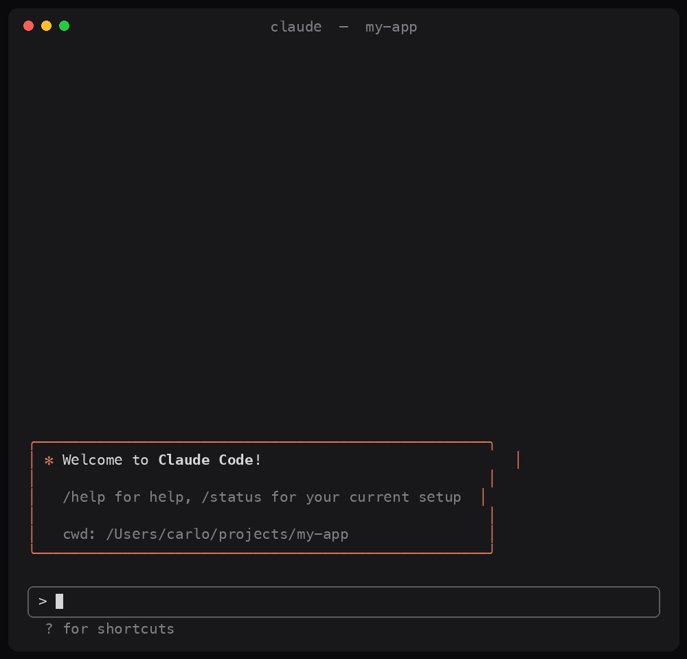

# scope-creep-receipt

You ask Claude Code for one small thing. It opens 43 tabs "just to check", starts 17 side quests and runs 9 commands on a hunch.

This mod prints the receipt, above the prompt, after every turn.

The GIF is a mock-up with made-up numbers. The mod itself counts the real ones: files read and searched, files edited, commands run, minutes, tokens. The stamp at the bottom depends on how far Claude wandered from what you asked.

Needs Claude Code 2.1.287 or later, and a terminal at least 44 columns wide.

## Install

In Claude Code:

    /plugin marketplace add mofocm/scope-creep-receipt
    /plugin install scope-creep-receipt@carlomakes-mods
    /reload-plugins

Or try it for one session only:

    git clone https://github.com/mofocm/scope-creep-receipt
    claude --plugin-dir ./scope-creep-receipt/plugin

## Use

It prints by itself after each turn. Two commands:

- `/receipt` reprints the last receipt
- `/receipt demo` prints a joke one (43 tabs, 17 side quests, 1 typo)

Press `tear off` to hide it.

## Read it before you install it

A mod is code that runs inside your Claude Code session. This one is about 190 lines, in `plugin/hooks/register.tsx`. It reads tool names and token counts. It does not touch your files, run commands or use the network.

## Make the GIF

`python3 make_gif.py out.gif` needs Pillow and the Menlo font (macOS).

MIT license.
